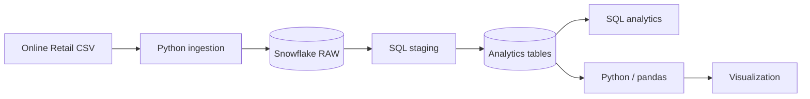
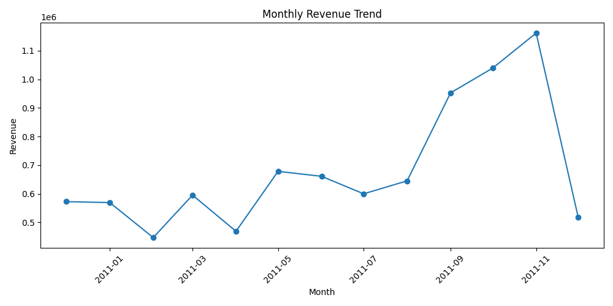

# Snowflake Retail Analytics Pipeline

An end-to-end **data engineering and analytics pipeline** using **Snowflake, SQL, and Python** to ingest, transform, validate, analyze, and visualize retail transaction data.

This project demonstrates a compact ELT workflow suitable for teaching, portfolio demonstration, and experimentation with cloud data warehousing.

## Architecture



See [`docs/architecture.md`](docs/architecture.md) for details.

## What the Pipeline Does

1. Loads the retail CSV into a Snowflake **RAW** table using Python and bounded-memory batches.
2. Creates a SQL **staging view** that filters invalid transactions and derives line revenue.
3. Builds **orders** and **customers** analytics tables.
4. Runs reusable SQL analytics queries.
5. Performs post-load quality checks.
6. Queries Snowflake from Python and produces a monthly revenue visualization.

## Technology Stack

- **Snowflake** — cloud data warehouse
- **SQL** — ELT transformations and analytics
- **Python** — ingestion, validation, querying, and visualization
- **pandas** — tabular processing
- **Snowflake Connector / SQLAlchemy** — Python-to-Snowflake connectivity
- **Matplotlib** — visualization

## Repository Structure

```text
snowflake-retail-analytics-pipeline/
├── README.md
├── requirements.txt
├── .env.example
├── data/
│   └── README.md
├── docs/
│   └── architecture.md
├── results/
│   └── monthly_revenue.png
├── sql/
│   ├── 00_setup.sql
│   ├── 01_schema.sql
│   ├── 02_staging.sql
│   ├── 03_transformations.sql
│   └── 04_analytics.sql
└── src/
    ├── config.py
    ├── load_data.py
    ├── validate_data.py
    ├── query_data.py
    └── visualize.py
```

## Dataset

The project uses the Online Retail transactional dataset from the original project. The raw dataset is not included in the cleaned repository because of its size.

Place the CSV at:

```text
data/Online_Retail.csv
```

See [`data/README.md`](data/README.md) for the expected schema and file assumptions.

## Setup

### 1. Create a Python environment

```bash
python -m venv .venv
```

Activate it and install dependencies:

```bash
pip install -r requirements.txt
```

### 2. Configure Snowflake credentials

Copy `.env.example` to `.env` and fill in your Snowflake credentials:

```text
SNOWFLAKE_USER=...
SNOWFLAKE_PASSWORD=...
SNOWFLAKE_ACCOUNT=...
SNOWFLAKE_WAREHOUSE=RETAIL_WH
SNOWFLAKE_DATABASE=RETAIL_DB
SNOWFLAKE_RAW_SCHEMA=RAW
SNOWFLAKE_ANALYTICS_SCHEMA=ANALYTICS
```

Never commit `.env`.

### 3. Create Snowflake objects

Run the SQL scripts in order:

```text
sql/00_setup.sql
sql/01_schema.sql
```

`00_setup.sql` requires a Snowflake role with permission to create the warehouse/database/schemas. If those objects already exist, you can adapt or skip that script.

### 4. Load the raw data

```bash
python src/load_data.py
```

Or provide a different CSV location:

```bash
python src/load_data.py --csv /path/to/Online_Retail.csv
```

### 5. Validate the load

```bash
python src/validate_data.py
```

The validation script reports row count, invoice-date range, missing customer IDs, and unit-price summary statistics.

### 6. Build the analytics layer

Run:

```text
sql/02_staging.sql
sql/03_transformations.sql
```

Then explore the queries in:

```text
sql/04_analytics.sql
```

### 7. Query from Python

```bash
python src/query_data.py
```

### 8. Generate the visualization

```bash
python src/visualize.py
```

The plot is written to `results/monthly_revenue.png`.

## Data Model

### RAW.RETAIL_RAW
Source-level retail transactions after datatype normalization required for loading.

### ANALYTICS.STG_RETAIL
Filters transactions with non-positive quantity or unit price and rows without a customer ID. It also derives `line_total`.

### ANALYTICS.ORDERS
One row per invoice/customer with order date and total order value.

### ANALYTICS.CUSTOMERS
Customer-level metrics including total orders and lifetime value by country.

## Example Analytics

The included SQL demonstrates:

- Top customers by lifetime value
- Monthly revenue trends
- Revenue by country through the Python query example

## Sample Result



## Engineering Improvements Made

The cleaned version of the original project:

- centralizes Snowflake configuration in one module;
- fixes the dataset filename/path mismatch;
- loads the CSV in bounded-memory chunks rather than materializing the full dataset as a Python list;
- uses explicit target columns for inserts;
- adds a dedicated post-load validation script;
- adds the missing Snowflake SQLAlchemy dependency;
- separates raw, staging, analytics, and consumption responsibilities;
- saves visualizations reproducibly instead of only displaying them interactively;
- keeps secrets and large raw datasets out of Git.

## Limitations and Next Steps

This project intentionally remains compact. Potential extensions include:

- Snowflake internal stages and `COPY INTO` for higher-throughput bulk loading
- automated orchestration with Airflow or Dagster
- dbt-based transformations and tests
- CI checks for Python and SQL
- additional data-quality assertions
- dashboarding with Streamlit, Tableau, or Power BI
- incremental ingestion rather than full-table reloads

## Author

**Mahdi Ebrahimi, Ph.D.**  
Associate Professor of Computer Science, California State University, Northridge  
[Academic Website](https://mebrahimii.github.io/) · [Big Data & AI Systems](https://github.com/BigDataAISystems)
