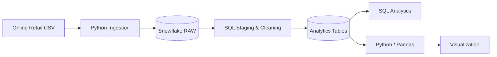

# Snowflake Retail Analytics Pipeline

An end-to-end **data engineering and analytics pipeline** using **Snowflake, SQL, and Python** for data ingestion, ELT transformations, validation, analytics, and visualization.

This project demonstrates how raw retail transaction data can be ingested into Snowflake, transformed into analytics-ready datasets, validated, queried, and analyzed using Python.

---

## Project Overview

The project uses the **Online Retail II** dataset to demonstrate a practical cloud data engineering workflow.

The pipeline covers:

- Raw CSV data ingestion with Python
- Cloud data storage in Snowflake
- SQL-based staging and transformation
- Analytics-ready data modeling
- Data validation
- SQL analytics
- Python and Pandas analysis
- Data visualization

The project emphasizes a clear separation between **raw data ingestion, data transformation, analytics, and presentation**.

---

## Architecture



The pipeline follows a simplified ELT architecture:

**Raw Data → Ingestion → Snowflake → Staging → Transformation → Analytics → Visualization**

---

## Technology Stack

| Technology | Purpose |
|---|---|
| **Snowflake** | Cloud data warehouse |
| **SQL** | Data modeling, transformation, and analytics |
| **Python** | Data ingestion, validation, querying, and visualization |
| **Pandas** | Data manipulation and analysis |
| **SQLAlchemy** | Python-to-Snowflake query integration |
| **Matplotlib** | Data visualization |
| **python-dotenv** | Environment-based configuration |

---

## Repository Structure

```text
snowflake-retail-analytics-pipeline/
│
├── README.md
├── requirements.txt
├── .env.example
├── .gitignore
│
├── data/
│   └── README.md
│
├── docs/
│   └── architecture.md
│
├── results/
│   └── monthly_revenue.png
│
├── sql/
│   ├── 00_setup.sql
│   ├── 01_schema.sql
│   ├── 02_staging.sql
│   ├── 03_transformations.sql
│   └── 04_analytics.sql
│
└── src/
    ├── config.py
    ├── load_data.py
    ├── validate_data.py
    ├── query_data.py
    └── visualize.py
```

---

## Data Pipeline

### 1. Data Source

The project uses the **Online Retail II** dataset, which contains transactional retail data such as:

- Invoice number
- Product/stock code
- Product description
- Quantity
- Invoice date
- Unit price
- Customer identifier
- Country

The raw dataset is intentionally **not stored in this repository**.

See:

```text
data/README.md
```

for instructions on obtaining and placing the dataset.

---

### 2. Python Data Ingestion

The ingestion layer reads the retail CSV file and loads the records into Snowflake.

The ingestion script:

```text
src/load_data.py
```

performs the following tasks:

1. Reads the source CSV
2. Processes the dataset in manageable chunks
3. Establishes a Snowflake connection
4. Loads records into the raw Snowflake table

Chunked processing avoids unnecessarily materializing the complete dataset as a large Python object before insertion.

---

### 3. Snowflake Raw Layer

Raw source data is first loaded into a Snowflake raw table.

This layer preserves the original transactional data before additional transformations are applied.

The database and initial environment are configured through:

```text
sql/00_setup.sql
sql/01_schema.sql
```

---

### 4. Staging and Data Cleaning

The staging layer prepares the raw data for downstream analytics.

Typical operations include:

- Data type preparation
- Filtering invalid records
- Handling incomplete values
- Standardizing fields
- Preparing transaction records for transformation

The staging logic is implemented in:

```text
sql/02_staging.sql
```

---

### 5. Analytics Transformations

The transformation layer converts staging data into structures that are more appropriate for analytics.

This step separates data preparation from analytical queries and demonstrates a simplified warehouse-style workflow.

Transformation logic is located in:

```text
sql/03_transformations.sql
```

---

### 6. Data Validation

A dedicated Python validation step checks the loaded and transformed data.

Run:

```bash
python src/validate_data.py
```

Validation helps verify that the pipeline produced the expected Snowflake objects and data before analytics are performed.

---

### 7. SQL Analytics

Analytical SQL queries are maintained separately from schema and transformation logic.

Examples of analytical questions can include:

- Revenue trends over time
- Customer purchasing behavior
- Product performance
- Geographic sales patterns
- Monthly transaction activity

Analytics queries are located in:

```text
sql/04_analytics.sql
```

---

### 8. Python Analytics

Python can query the Snowflake analytics layer for additional analysis.

Run:

```bash
python src/query_data.py
```

This demonstrates how Snowflake can serve as the cloud analytical backend while Python provides an application and analysis layer.

---

### 9. Visualization

The visualization workflow retrieves analytical data from Snowflake and generates a revenue visualization using Python.

Run:

```bash
python src/visualize.py
```

The generated figure is stored under:

```text
results/
```

---

## Sample Result

Example monthly revenue analysis produced by the pipeline:


---

## Getting Started

### Prerequisites

You will need:

- Python 3
- A Snowflake account
- Access to the Online Retail dataset
- Git

---

## Installation

Clone the repository:

```bash
git clone https://github.com/BigDataAISystems/snowflake-retail-analytics-pipeline.git
cd snowflake-retail-analytics-pipeline
```

Create a virtual environment:

```bash
python -m venv .venv
```

Activate it.

### macOS / Linux

```bash
source .venv/bin/activate
```

### Windows

```powershell
.venv\Scripts\activate
```

Install the required packages:

```bash
pip install -r requirements.txt
```

---

## Snowflake Configuration

Copy the example environment file:

### macOS / Linux

```bash
cp .env.example .env
```

### Windows

```powershell
copy .env.example .env
```

Then update `.env` with your Snowflake credentials and configuration.

For example:

```env
SNOWFLAKE_USER=your_username
SNOWFLAKE_PASSWORD=your_password
SNOWFLAKE_ACCOUNT=your_account
SNOWFLAKE_WAREHOUSE=your_warehouse
SNOWFLAKE_DATABASE=your_database
SNOWFLAKE_SCHEMA=your_schema
SNOWFLAKE_ROLE=your_role
```

**Do not commit `.env` to GitHub.**

The `.gitignore` file is configured to prevent local credentials from being committed.

---

## Dataset Setup

Place the Online Retail CSV file in:

```text
data/Online_Retail.csv
```

The dataset itself is excluded from Git because raw datasets can be large and may have separate distribution or licensing requirements.

See `data/README.md` for additional information.

---

## Running the Pipeline

### Step 1 — Configure Snowflake

Run the SQL scripts in numerical order:

```text
sql/00_setup.sql
sql/01_schema.sql
sql/02_staging.sql
sql/03_transformations.sql
```

Depending on your Snowflake environment, some setup statements may need to be adjusted for your account and permissions.

---

### Step 2 — Load the Dataset

```bash
python src/load_data.py
```

---

### Step 3 — Run Transformations

Execute the staging and transformation SQL scripts as required:

```text
sql/02_staging.sql
sql/03_transformations.sql
```

---

### Step 4 — Validate the Pipeline

```bash
python src/validate_data.py
```

---

### Step 5 — Run Analytics

Execute:

```text
sql/04_analytics.sql
```

or query the analytics layer from Python:

```bash
python src/query_data.py
```

---

### Step 6 — Generate Visualization

```bash
python src/visualize.py
```

The generated visualization is saved under:

```text
results/
```

---

## Design Principles

This project follows several basic data-engineering practices.

### Separation of Concerns

Ingestion, transformation, validation, analytics, and visualization are maintained as separate components.

### Environment-Based Configuration

Snowflake credentials and environment-specific configuration are stored outside the source code.

### SQL Organization

SQL files are ordered according to their role in the pipeline:

```text
00_setup
   ↓
01_schema
   ↓
02_staging
   ↓
03_transformations
   ↓
04_analytics
```

### Reproducibility

The repository contains:

- Dependency definitions
- Environment configuration template
- Dataset instructions
- Ordered SQL scripts
- Python pipeline components
- Example analytical output

---

## Data Engineering Concepts Demonstrated

This project demonstrates several fundamental data-engineering concepts:

- Cloud data warehousing
- ELT pipelines
- Raw and staging layers
- SQL transformations
- Analytics data modeling
- Data validation
- Environment-based configuration
- Python/database integration
- Analytical querying
- Data visualization

---

## Future Improvements

Possible extensions include:

- Snowflake internal or external stages
- `COPY INTO` for scalable bulk ingestion
- Snowpipe for automated ingestion
- Incremental data loading
- Data-quality frameworks
- dbt-based transformations
- Apache Airflow orchestration
- Automated testing
- CI/CD workflows
- Additional analytical models
- Dashboard integration
- Performance and cost analysis

For significantly larger datasets, Snowflake-native bulk-loading mechanisms such as **stages and `COPY INTO`** would be preferable to client-side row insertion.

---

## Project Context

This repository is part of the **Big Data & AI Systems** collection of research, engineering, and open-source projects.

The broader project portfolio explores:

- Big Data
- Data Engineering
- Distributed Data Processing
- Cloud Computing
- AI-Powered Data Systems
- Scalable Retrieval-Augmented Generation
- Vector Search
- LLM-Powered Data Analytics

Visit the organization:

**[Big Data & AI Systems](https://github.com/BigDataAISystems)**

---

## Author

**Mahdi Ebrahimi, Ph.D.**  
Associate Professor of Computer Science  
California State University, Northridge (CSUN)

Research interests include **Big Data, large-scale data systems, cloud computing, distributed data processing, optimization, and AI-powered data systems**.

- Academic website: [https://mebrahimii.github.io](https://mebrahimii.github.io)
- GitHub organization: [https://github.com/BigDataAISystems](https://github.com/BigDataAISystems)

---

## License

This project is intended for **educational, research, and portfolio purposes**.

If you plan to distribute or reuse the project under a specific open-source license, add the corresponding `LICENSE` file to the repository.
