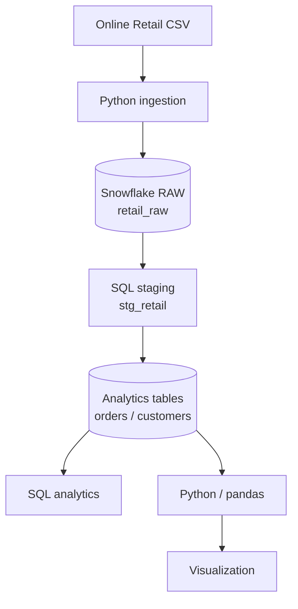

# Architecture

The project follows a simple ELT-style analytics architecture.

## Layers

### Raw
`RAW.RETAIL_RAW` preserves source-level records after only datatype normalization required for loading.

### Staging
`ANALYTICS.STG_RETAIL` filters invalid business records (`quantity <= 0`, `unit_price <= 0`, and missing customer IDs) and derives `line_total`.

### Analytics
`ANALYTICS.ORDERS` aggregates invoice-level order totals, while `ANALYTICS.CUSTOMERS` creates customer-level order and lifetime-value metrics.

### Consumption
SQL queries and Python scripts consume the analytics layer for analysis and visualization.
